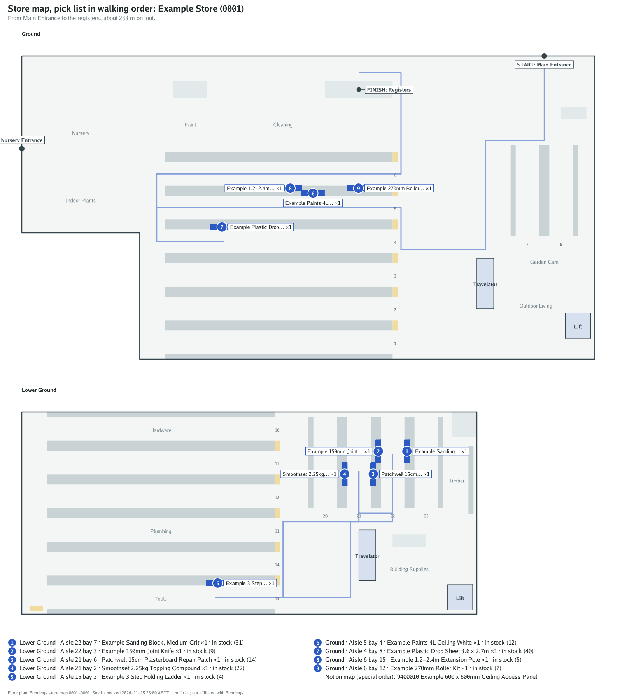
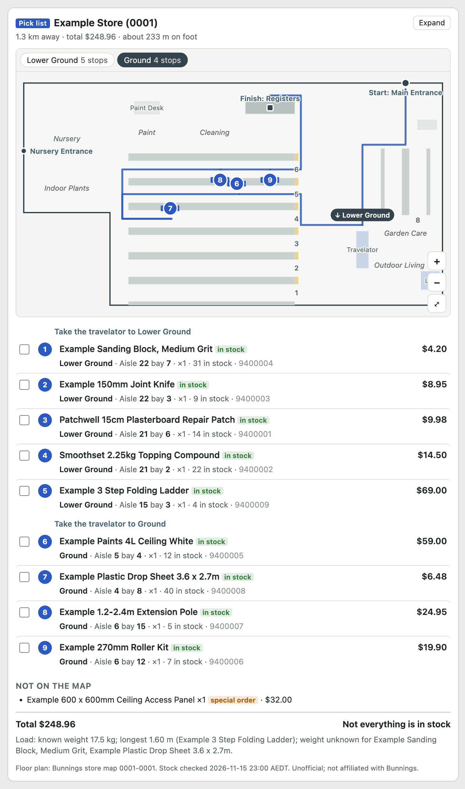

# snag-mcp

Snag is an MCP server for shopping at Bunnings in person. It lets an assistant find
products that are actually sold near you, check a whole project list against
live stock, and give you a pick list for the store you go to, in walking order,
with a floor plan of that store showing where each item is.

Unofficial, and not affiliated with or endorsed by Bunnings. It uses the same
public APIs the Bunnings website uses from your browser, with the guest access
any anonymous visitor gets: no account, no API key, no browser.

## Use

Snag is an unofficial personal tool, for personal, non-commercial use only.

- You are responsible for complying with Bunnings'
  [website terms of use](https://www.bunnings.com.au/terms-conditions/website-terms-of-use)
  when you use it.
- Do not use it for bulk collection of Bunnings' data, and do not run it as a
  service for other people. It is built to answer one person's questions, a
  few requests at a time.
- It sends a desktop browser's User-Agent (Chrome on macOS) with its requests to
  Bunnings and Bazaarvoice, because those services expect one, and a Referer
  for Bunnings' store map viewer, as the viewer itself does.

The assistant does the judgment (what a 3 x 4 m deck needs, which product, how
many, whether it fits in the car). The server returns accurate, location-filtered
data and does the batch work.

**Only what you can buy near you.** Bunnings ranges differ by state and store,
and its data carries prices against stores that do not sell an item at all: a
WA-only cement shows $1.54 in Melbourne, where it is not sold, and $13.22 in
Perth, where it is. An item appears only if a store within your radius sells it
In-Store or Click & Collect, is active there, and has a real price there.
Marketplace listings (third-party sellers, delivery only) never appear. Every
answer says which location, what radius, and how many stores it covered.

**One trip for the whole list.** Give it a list and it ranks every store in
range by how many lines each can fill from stock right now, with each store's
cost and what is missing. Or name a store and get a pick list with exact stock
and a total.

**A map of the store.** The pick list for one store comes in walking order:
from the main entrance, round every bay with something to pick up, to the
registers, planned over the store's own walking graph (the one Bunnings' map
viewer gives directions with). A floor plan is attached as an image, each bay
highlighted and numbered to match the list, with the route drawn. The text and
structured output carry the same order and the bay coordinates, so a client
that shows no images, or wants to draw its own, loses nothing. Lines with
nothing to pick up (special orders, out of stock, not sold there) are listed as
not on the map. Pass `map: false` for plain aisle and bay order.

For example, someone asks:

> *I've got a fist-sized hole in my plasterboard ceiling. What do I need to
> patch it and paint it ceiling white, and where is it all at Example Store?*

The assistant works out the job and picks products with `search_products`, then
calls `check_list` for the store, which returns:

```text
Pick list for Example Store (1.3 km). Total $248.96. Not everything is in stock. Walking order from Main Entrance (Ground) to the registers, about 233 m on foot over the store's floor plan. A floor plan with the stops numbered is attached.
Take the travelator to Lower Ground.
1. Lower Ground: 9400004 x1 Example Sanding Block, Medium Grit: in_stock, aisle 22 bay 7, $4.20, stock 31
2. Lower Ground: 9400003 x1 Example 150mm Joint Knife: in_stock, aisle 22 bay 3, $8.95, stock 9
3. Lower Ground: 9400001 x1 Patchwell 15cm Plasterboard Repair Patch: in_stock, aisle 21 bay 6, $9.98, stock 14
4. Lower Ground: 9400002 x1 Smoothset 2.25kg Topping Compound: in_stock, aisle 21 bay 2, $14.50, stock 22
5. Lower Ground: 9400009 x1 Example 3 Step Folding Ladder: in_stock, aisle 15 bay 3, $69.00, stock 4
Take the travelator to Ground.
6. Ground: 9400005 x1 Example Paints 4L Ceiling White: in_stock, aisle 5 bay 4, $59.00, stock 12
7. Ground: 9400008 x1 Example Plastic Drop Sheet 3.6 x 2.7m: in_stock, aisle 4 bay 8, $6.48, stock 40
8. Ground: 9400007 x1 Example 1.2-2.4m Extension Pole: in_stock, aisle 6 bay 15, $24.95, stock 5
9. Ground: 9400006 x1 Example 270mm Roller Kit: in_stock, aisle 6 bay 12, $19.90, stock 7
- (not on map) 9400010 x1 Example 600 x 600mm Ceiling Access Panel: special_order, no location, $32.00
Load: known weight 17.5 kg, longest 1.60 m (Example 3 Step Folding Ladder); weight unknown for 2 item(s).
```

and this floor plan:



*Example Store is synthetic: an invented two-floor store with invented
products, prices and stock, served to the real tools by
`go run ./scripts/example-store -demo DIR`, which wrote both the text and the
image above. Against the real site the output has the same shape. The footer
is the attribution every map carries.*

**Fittings that fit.** `get_product` gathers every statement Bunnings makes
about how a fitting connects (thread, gender, size, push-fit system), quoted
from the specs, name, key points and description and labelled with where each
came from, never interpreted: a spec of "15" stays "15". It also lists the
installation guides, spec sheets, manuals and safety data sheets Bunnings
publishes, as links, and says plainly when there are none. `search_products`
takes a `brand`, matched against the brands sold nearby however it is spelt or
misspelt, so a search can stay inside one push-fit system.

**What other buyers said.** `get_reviews` returns review text, ratings, dates
and helpful votes, most helpful or most recent first, and the questions buyers
asked with their answers.

**What you are carrying home.** Each list comes with the longest item and the
total known weight, from Bunnings' published package dimensions and weights.
Anything Bunnings does not publish is listed as unknown, never estimated.

## Tools

| Tool | What it does |
|---|---|
| `set_location` | Saves your postcode or suburb; every other tool works from it |
| `search_products` | Products sold in person near you, with nearby prices; optional `brand` filter, tolerant of spelling; suggests brands when none match |
| `get_product` | Details for comparing: specs, connection details, documents, rating, dimensions, weight, nearest price |
| `get_reviews` | Reviews (text, rating, date, helpful votes) and questions with answers |
| `check_list` | A list against live stock: stores ranked, or a walking-order pick list and floor plan for one store |

A sixth, `get_store_layout`, is for the pick-list view below and is never
offered to the model.

## In the chat: MCP Apps

In hosts that render [MCP Apps](https://modelcontextprotocol.io/extensions/apps/overview)
(the `io.modelcontextprotocol/ui` extension: Claude on the web, desktop and
mobile, ChatGPT, Cursor, and VS Code behind a setting, at the time of writing;
Claude Code does not), `check_list` shows its answer inline as an interactive
view rather than only as text with a PNG inside the collapsed tool result:

- the pick list in walking order, each line with its stop number, floor,
  aisle and bay, quantity, price, stock and status, a tickbox to mark it
  picked up (kept in the view only), the total and the load summary, and the
  lines with nothing to pick up listed separately;
- the store's floor plan drawn from Bunnings' plan data, so it stays sharp at
  any zoom: pinch, ctrl or cmd and scroll, double-click or the buttons to zoom,
  drag to pan, a floor switcher in multi-storey stores, the walking route,
  the entrance and the registers, and each stop numbered. Hovering or tapping
  a stop highlights its line and the reverse; tapping a line takes the map to
  its stop.

It follows the host's light or dark theme and fits a narrow chat column. A
ranking of stores (no `store`) shows as a table.



*The view for the same list on Example Store, the synthetic store above,
screenshotted in headless Chrome by `scripts/app-preview` playing the host. In
Claude Desktop it shows inline in the chat. The static PNG above is what hosts
without MCP Apps show, and what the view falls back to.*

The view is one self-contained HTML page built into the binary. It loads
nothing and connects nowhere, so it runs under the hosts' most restrictive
content policy; its data comes from the host. The pick list is `check_list`'s
own result. The floor plan, too large for the model's context (Mentone has
1,672 bays and a 5 MB walking graph), comes from `get_store_layout`, which the
view calls through the host: a simplified plan from the map already cached for
`check_list`, about 75 KB for Mentone and capped at 1 MB, with the walking
route between the stops.

**Hosts without MCP Apps get exactly what they got before**: the text, the
PNG and the JSON, and no `get_store_layout` in the tool list. If the view's
layout call fails, it shows the PNG from the result instead.

To confirm a host negotiated it, look at the server's stderr, which Claude
Desktop writes to `~/Library/Logs/Claude/mcp-server-<name>.log`. Each time the
host lists the tools, the server logs one of:

```
snag-mcp: client "..." declares io.modelcontextprotocol/ui {"mimeTypes":["text/html;profile=mcp-app"]}: check_list shows the pick-list app
snag-mcp: client "..." does not declare io.modelcontextprotocol/ui with text/html;profile=mcp-app: plain results, get_store_layout hidden
```

## Location

Asked for on first use and remembered. If your client supports MCP
elicitation it prompts you directly; otherwise the assistant is told to ask you
and call `set_location`. Every tool takes a `location` to override it for one
call, and a `radius_km` (default 50).

Postcodes and suburbs are resolved offline from an embedded copy of GeoNames'
Australian postcode data, so your location is never sent to a geocoder; the
only thing that leaves your machine is the postcode's coordinates, sent to
Bunnings to find stores near them. Nothing guesses your location from your IP
address. It is saved owner-only at `snag-mcp -config-path`.

If no store is within the radius, the answer says so and names the nearest
store and its distance, so the assistant can ask before looking further.

## Install

Requires Go 1.25 or later; use Go 1.27.3 or 1.26.10 or later, which fix a
crypto/x509 flaw reachable through the server's HTTPS calls (GO-2026-6809).
Builds from a checkout (and CI, and the bundle) use 1.27.3, the toolchain
go.mod names, fetching it if needed; `go install ...@latest` does not read that
line and builds with the `go` you have.

```sh
go install github.com/kensantoso/snag-mcp/cmd/snag-mcp@latest
snag-mcp -set-location 3194   # optional; it will ask otherwise
```

Then point any MCP client at the binary. The server speaks MCP over stdio with
no vendor extensions (MCP Apps, above, is an official MCP extension, offered to
hosts that ask for it):

```json
{
  "mcpServers": {
    "snag": { "command": "/absolute/path/to/snag-mcp" }
  }
}
```

| Client | Where |
|---|---|
| Claude Code | `claude mcp add -s user snag -- /path/to/snag-mcp` |
| Claude Desktop | `~/Library/Application Support/Claude/claude_desktop_config.json`, or `%APPDATA%\Claude\` on Windows |
| Cursor, Windsurf, Zed, Amp | same JSON, their own config file |

### Packaged bundle

Claude Desktop also takes a `.mcpb`:

```sh
go build -o bundle/server/snag-mcp ./cmd/snag-mcp
cp LICENSE THIRD_PARTY_LICENSES internal/geo/DATA_LICENSE bundle/server/
codesign --force -s - bundle/server/snag-mcp     # macOS; see Caveats
npx @anthropic-ai/mcpb pack bundle snag-mcp.mcpb
```

## What you can ask

> *I'm building a 3 x 4 m deck in Mentone. What timber and screws do I need,
> and which store has it all?*
> *Find me a 10 mm masonry drill bit near 3194.*
> *Compare these two pressure washers.*
> *Give me a pick list and map for Moorabbin.*
> *I need a 16 mm push-fit female BSP connector. What thread is it, and is
> there an install guide?*
> *What do people say about this tap?*
> *Will this fit in a small hatchback?*

## Caveats

**Stock and prices are live, and change.** Stock is an exact count at the time
of the call, which `check_list` stamps. Bunnings' own website is the authority.

**Special orders have no stock count.** Some items (certain timber lengths,
for instance) are ordered in store rather than taken off the shelf. They show
as `special_order`, not as in stock.

**Be a good guest.** At most four requests are in flight at once and nothing
retries in a loop. A whole list across every store within 50 km of Melbourne
is a handful of requests, because stock for many stores and items comes back
in one call.

**Store maps are big, and cached.** A floor plan and its walking graph are
about 7 MB for a large store. They are downloaded only for a store you ask
for a pick list at, kept under your user cache directory
(`~/Library/Caches/snag-mcp/maps` on macOS), and checked for a newer
version after three days; Bunnings' viewer itself caches them for a year. A
store with no published plan gets aisle and bay order and a note saying so.
Multi-storey stores (Hawthorn, Alexandria, Rose Bay...) are drawn a floor at a
time, the walk finishes one floor before taking the lift, and the text names
each stop's floor and says where to take the lift, stairs or travelator. Bays are where
the store's own location lookup puts each item; Bunnings' plan is the
authority, and a store may have been rearranged since it was drawn.

**Reviews come from Bazaarvoice**, the service the Bunnings website shows them
from, read with the public display key from the site's own Bazaarvoice widget
config. The key is fetched from that config at runtime, so a rotation is picked
up; a copy embedded in the binary is the fallback if the config cannot be
read, and is tried once if Bazaarvoice rejects the fetched one. Reviews are
shared with Bunnings New Zealand, and each says which country it came from.
Few products have questions.

**Re-sign the binary if you replace one inside an installed bundle.** macOS
caches a signature against a path, so overwriting in place gets the process
killed on launch with no output at all: an empty log and exit 137 is this.

## Layout

```
cmd/snag-mcp         flags, server startup
internal/bunnings    the website's APIs: guest token, stores, search, stock, aisles, products
internal/geo         postcode/suburb to a point, offline
internal/shop        the availability rule, pick lists, store ranking, load summary,
                     brand matching, documents and connection details
internal/storemap    store floor plans: parsing, walk planning, drawing (pure Go)
internal/tools       the five tools, and the pick-list MCP App (internal/tools/app)
scripts/app-preview  the MCP App in headless Chrome, with a script playing the host
scripts/example-store the synthetic store and products behind the tests and the pictures here
e2e                  opt-in live tests against bunnings.com.au
```

## Tests

```sh
go test ./...                                   # offline, over invented fixtures
BUNNINGS_LIVE=1 go test -v -timeout 15m ./e2e   # live: the built binary over stdio
```

The live tests drive the built binary as an MCP client and check what it
returns against the website itself: its APIs called separately, and, with
Chrome and Node 22+ installed, the product page rendered in headless Chrome with
the store selected. They also check the invariants: a WA-only cement and a
marketplace shower seat never appear for a Melbourne postcode, and the cement
does for Perth, including with a brand filter. For the store map they check
Mentone and Subiaco against Bunnings' map viewer and the website's own aisle
lookup: the map id, that every numbered stop is the bay the website gives for
its items, and that the list's order is the walk's. Set `BUNNINGS_E2E_OUT` to a
directory to keep the rendered maps for inspection. For the MCP App they check
that a host declaring the extension gets the same `check_list` result as one
that does not, and that the view's layout call for Mentone and Hawthorn returns
each stop's bay and a route into it.

To see the MCP App, `scripts/app-preview/preview.py` plays the host: it runs
the built server over stdio, records `check_list` and the layout call, and
screenshots the view in headless Chrome, in light or dark, at any width, after
clicking a floor or a line (see the script for options).

## Data

Product, price, stock, store and floor plan data come from Bunnings and remain
theirs; reviews come from Bazaarvoice and their authors. The tools fetch them at
the time you ask and keep only the store maps, in your own cache. None of it is
in this repository: the offline tests' fixtures, the example store and the
pictures above are invented, in the shapes the APIs return (see
`scripts/example-store`). Only the opt-in live tests name real items and
stores, and they store nothing.

Postcode locations are from [GeoNames](https://www.geonames.org), licensed
under [CC BY 4.0](https://creativecommons.org/licenses/by/4.0/); see
`internal/geo/DATA_LICENSE`. Store maps are drawn with
[golang.org/x/image](https://pkg.go.dev/golang.org/x/image) and the
[Go fonts](https://go.dev/blog/go-fonts) by Bigelow & Holmes, both under the
BSD-style Go licence and built into the binary; see `THIRD_PARTY_LICENSES`.
The code is MIT licensed.
